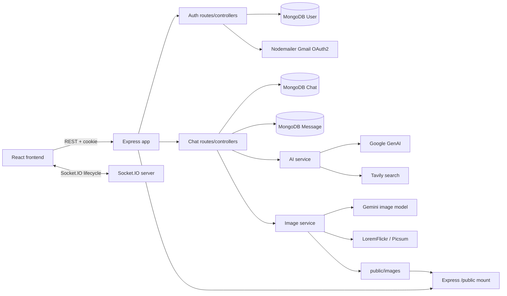

# Perplexity Clone — Technical Reference

This reference describes the implementation present in the repository's main branch. It traces requests from the React UI through Express controllers, MongoDB models, Gemini/Tavily integrations, static image serving, and Socket.IO. It distinguishes verified source behavior from implementation risks and externally controlled behavior.

## Contents

1. [Scope and architecture](#1-scope-and-architecture)
2. [Repository and execution entry points](#2-repository-and-execution-entry-points)
3. [Configuration and startup](#3-configuration-and-startup)
4. [HTTP API reference](#4-http-api-reference)
5. [Authentication and account lifecycle](#5-authentication-and-account-lifecycle)
6. [Chat and AI request lifecycle](#6-chat-and-ai-request-lifecycle)
7. [Image generation lifecycle](#7-image-generation-lifecycle)
8. [Data models and relationships](#8-data-models-and-relationships)
9. [Frontend state and UI flows](#9-frontend-state-and-ui-flows)
10. [Socket.IO behavior](#10-socketio-behavior)
11. [External services and dependencies](#11-external-services-and-dependencies)
12. [Security and failure observations](#12-security-and-failure-observations)
13. [Operations and troubleshooting](#13-operations-and-troubleshooting)
14. [File-level traceability](#14-file-level-traceability)

## 1. Scope and architecture

### 1.1 Application capabilities

Perplexity is a full-stack conversational AI application. The current code implements registration/login, cookie-based JWT authentication, user-owned chat history, text conversations with Gemini, an optional Tavily-backed web-search context path, image generation with fallback image providers, chat/message deletion, and a React UI with light/dark themes.

The system has two application processes:

- **Backend:** Node.js ES modules, Express 5, Mongoose/MongoDB, provider service modules, and a Socket.IO server attached to the HTTP server.
- **Frontend:** React, Vite, Redux Toolkit, React Router, Axios, SCSS/Tailwind tooling, Markdown rendering, syntax highlighting, and a Socket.IO client.

The repository does **not** currently implement AI token streaming over Socket.IO. The Socket.IO server logs client connection/disconnection only; chat and image operations use REST. The web-search path retrieves Tavily results and inserts serialized results into the Gemini system instruction. It does not use vector embeddings or a vector database.

### 1.2 System architecture



### 1.3 Request classes

| Class | Transport | Authentication | Behavior |
|---|---|---|---|
| Auth REST | HTTP JSON | Register/login/verify/logout are public; get-me requires cookie | Account creation, login, session lookup, verification, logout |
| Chat REST | HTTP JSON | All chat routes use authUser | Text prompt, image generation, chat/message retrieval and deletion |
| Static files | HTTP static mount | No auth middleware | Serves files under backend public directory, including generated images |
| Socket.IO | Socket.IO polling/WebSocket | No socket authentication middleware configured | Connection/disconnection logging only |

### 1.4 Architecture boundaries

- MongoDB stores users, chats and messages.
- Redux holds the current client-side chat map. Only the selected chat ID is persisted in browser Local Storage.
- Axios sends cookies because the shared client enables withCredentials.
- No queue, background worker, cron task, distributed cache, object-storage provider, message pagination, or transaction framework is implemented.
- Provider APIs, email delivery, static file access and browser cookie policies may fail independently.

## 2. Repository and execution entry points

### 2.1 Backend

| Path | Responsibility |
|---|---|
| `Backend/server.js` | Loads dotenv configuration, creates an HTTP server, initializes Socket.IO, starts MongoDB connection and listens |
| `Backend/src/app.js` | Express middleware, CORS, root response, static files and route mounts |
| `Backend/src/config/database.js` | Mongoose connection using MONGODB_URI |
| `Backend/src/routes/auth.route.js` | Auth endpoint registrations |
| `Backend/src/routes/chats.route.js` | Chat endpoint registrations |
| `Backend/src/controllers/auth.controller.js` | Registration, login, profile lookup, verification and logout |
| `Backend/src/controllers/chat.controller.js` | Text/image workflows, chat/message retrieval and deletion |
| `Backend/src/middlewares/auth.middleware.js` | Reads and verifies the token cookie |
| `Backend/src/validators/auth.validator.js` | Registration/login validation |
| `Backend/src/models/user.model.js` | User schema, password hash hook and compare method |
| `Backend/src/models/chat.model.js` | Chat schema |
| `Backend/src/models/message.model.js` | Message schema and parent-message link |
| `Backend/src/services/ai.service.js` | Gemini title/response generation, optional search context and transient retry logic |
| `Backend/src/services/internet.service.js` | Tavily search wrapper |
| `Backend/src/services/image.service.js` | Gemini image generation and remote-image fallbacks |
| `Backend/src/services/mail.service.js` | Nodemailer Gmail OAuth2 transport |
| `Backend/src/sockets/server.socket.js` | Socket.IO setup and connection/disconnection handlers |
| `Backend/seed.js` | Test-user seed/reseed script |
| `Backend/test-oauth.js` | Manual Google refresh-token probe |
| `Backend/test_gemini.js` | Manual Gemini text-generation probe |
| `Backend/test_gemini_history.js` | Manual Gemini history probe |
| `Backend/test_langchain.js` | Manual LangChain Google model probe |
| `Backend/package.json` | Backend dependencies and scripts |
| `Backend/public/images/` | Checked-in image files; generated images are also written here relative to the process working directory |

The test files are utility scripts, not an automated integration suite. Backend's current npm test script prints that no test is specified and exits with status 1.

### 2.2 Frontend

| Path | Responsibility |
|---|---|
| `frontend/src/main.jsx` | Creates React root and Redux Provider |
| `frontend/src/api.js` | Shared Axios client, API base URL, credentials and timeout |
| `frontend/src/app/App.jsx` | Calls get-me on app mount and provides the route tree |
| `frontend/src/app/app.routes.jsx` | Login/register routes and protected dashboard |
| `frontend/src/app/app.store.js` | Combines auth and chat reducers |
| `frontend/src/app/index.css` | Global styling, Tailwind import, focus and animation styles |
| `frontend/src/features/auth/auth.slice.js` | Auth Redux state |
| `frontend/src/features/auth/hooks/useAuth.js` | Registration, login, session restore and logout |
| `frontend/src/features/auth/components/Protected.jsx` | Loading guard and unauthenticated redirect |
| `frontend/src/features/auth/pages/Login.jsx` | Login form |
| `frontend/src/features/auth/pages/Register.jsx` | Registration form |
| `frontend/src/features/auth/services/auth.api.js` | Auth API wrappers |
| `frontend/src/features/auth/styles/` | Authentication SCSS |
| `frontend/src/features/chats/chat.slice.js` | Chat map, selection, messages, loading/error state, selected-chat persistence |
| `frontend/src/features/chats/hooks/useChat.jsx` | Chat API calls and Redux updates |
| `frontend/src/features/chats/pages/Dashboard.jsx` | Main chat UI, sidebar, renderers, theme and request-mode controls |
| `frontend/src/features/chats/services/chat.api.js` | Chat API wrappers |
| `frontend/src/features/chats/services/chat.socket.js` | Socket.IO connection setup and logging |
| `frontend/src/features/chats/styles/dashboard.scss` | Dashboard and responsive styling |
| `frontend/vite.config.js` | Vite port and local proxy configuration |
| `frontend/package.json` | Frontend dependencies and commands |
| `frontend/.env` | Contains VITE_API_URL configuration; the configured value is not reproduced here |

### 2.3 Active versus auxiliary files

The active frontend entry is `frontend/src/main.jsx` → `frontend/src/app/App.jsx`. Test scripts and `Backend/seed.js` are utilities and are not registered as routes. No Backend .env.example file appears in the inspected tree. Configure local environment values without committing secrets.

## 3. Configuration and startup

### 3.1 Backend startup sequence

**Entry point:** `Backend/server.js`.

1. `import "dotenv/config"` loads dotenv configuration.
2. The module imports the Express app, database connector and Socket.IO initializer.
3. `http.createServer(app)` creates one Node HTTP server around Express.
4. `initSocket(httpServer)` attaches Socket.IO.
5. `connectDB()` starts the Mongoose connection attempt using `process.env.MONGODB_URI`. Rejection is caught and logged.
6. The HTTP server immediately calls `listen(process.env.PORT || 8000)`.
7. A successful listener start logs the port.

**Startup observation:** the database connection is not awaited before listening. The HTTP server can accept requests before MongoDB has connected; a failed connection is logged but does not stop the HTTP listener.

### 3.2 Express middleware order

In `Backend/src/app.js`, middleware is registered in this order:

1. `express.json()`
2. `express.urlencoded({ extended: true })`
3. `cookieParser()`
4. `morgan("dev")`
5. CORS middleware with a hard-coded origin allowlist, credentials enabled and explicit methods
6. `GET /` fixed JSON response
7. Static file mount at `/public`
8. Router mount at `/api/auth`
9. Router mount at `/api/chats`

No custom not-found or terminal error middleware is registered after the routers. Controllers with local try/catch return their own error bodies. Uncaught async failures are forwarded by Express 5 to default error handling, which may not return the JSON shape used by controllers.

`app.set("trust proxy", 1)` is configured so Express can interpret the first reverse proxy's protocol headers.

### 3.3 Frontend startup and API client

1. `frontend/src/main.jsx` creates the React root and wraps App in the Redux Provider.
2. The store combines the auth and chat reducers.
3. App mounts and invokes `useAuth().handleGetMe()` in an effect.
4. Protected displays a loading state while auth is loading, then redirects to `/login` if no user exists.
5. After authentication, route `/` renders Dashboard.
6. Dashboard mount starts the Socket.IO client and fetches the user's chat list.
7. The shared Axios client uses `withCredentials: true` and a 60-second timeout.

`frontend/src/api.js` builds the base URL:
- If `VITE_API_URL` is set, one trailing slash is removed and `/api` is appended.
- Otherwise, the relative base `/api` is used and Vite's local proxy handles it.

`frontend/vite.config.js` fixes Vite to port 5173 with `strictPort: true` and proxies `/api`, `/public` and `/socket.io` to `http://localhost:3000`. The socket proxy enables WebSocket forwarding.

**Local port mismatch:** Backend `server.js` defaults to port 8000 while the Vite proxy targets port 3000. Local development therefore needs `PORT=3000` for the backend or a matching proxy change.

### 3.4 Environment variables

The table lists names and purposes only; secret values must not be committed or copied into documentation.

| Variable | Read by | Purpose | Behavior |
|---|---|---|---|
| `PORT` | `Backend/server.js` | HTTP listening port | Optional; defaults to 8000 |
| `NODE_ENV` | `auth.controller.js` | Selects development auto-verification versus production email verification | Any value other than exactly `production` selects auto-verification |
| `MONGODB_URI` | `database.js`, `seed.js` | MongoDB connection string | Required for persistence |
| `JWT_SECRET` | Auth controller and middleware | Signs/verifies auth and verification JWTs | Required for auth routes |
| `GEMINI_API_KEY` | AI/image services and manual probes | Google GenAI access | Required for Gemini generation |
| `TAVILY_API_KEY` | Internet service | Tavily search | Required for actual web-search results |
| `PUBLIC_API_URL` | Registration controller | Public API base used in verification-email link | Optional; falls back to request protocol and host |
| `GOOGLE_CLIENT_ID` | Mail service/test script | Gmail OAuth2 client ID | Required for production mail |
| `GOOGLE_CLIENT_SECRET` | Mail service/test script | Gmail OAuth2 client secret | Required for production mail |
| `GOOGLE_REFRESH_TOKEN` | Mail service/test script | Gmail OAuth2 refresh token | Required for production mail |
| `GOOGLE_USER` | Mail service | Gmail sender/account identity | Required for mail delivery |
| `VITE_API_URL` | Frontend API client and Socket.IO client | Backend origin used outside the relative fallback | Optional in local proxy setup; browser-visible, not a secret |

The tree includes a tracked `frontend/.env` with `VITE_API_URL`; its value is intentionally omitted. Vite-prefixed variables are exposed in frontend code and must never contain private credentials.

### 3.5 Scripts and runtime requirements

Backend:
- `npm run dev` invokes `npx nodemon server.js`.
- There is no dedicated `start` script.
- `npm test` is a placeholder that exits non-zero.

Frontend:
- `npm run dev` starts Vite.
- `npm run build` creates `dist/`.
- `npm run preview` serves the build locally.
- `npm run lint` runs ESLint.

Direct package version ranges are declared separately in Backend/package.json and frontend/package.json; lockfiles contain the resolved dependency trees.


## 4. HTTP API reference

### 4.1 Conventions and route inventory

JSON and URL-encoded bodies are parsed in the Express app. Authenticated routes use `authUser`, which reads a cookie named `token`. There is no shared response-envelope contract: error bodies vary by controller, and default Express errors may not be JSON.

| Method | Route | Authentication | Purpose |
|---|---|---|---|
| GET | `/` | Public | Fixed server-running response |
| POST | `/api/auth/register` | Public | Create account |
| POST | `/api/auth/login` | Public | Check password, issue JWT cookie |
| GET | `/api/auth/get-me` | Cookie | Fetch current account |
| GET | `/api/auth/verify-email?token=...` | Query token | Verify email and return HTML |
| POST | `/api/auth/logout` | Public | Clear cookie |
| POST | `/api/chats/message` | Cookie | Persist prompt and AI answer |
| POST | `/api/chats/generate-image` | Cookie | Generate/fetch image and persist Markdown image response |
| GET | `/api/chats` | Cookie | List current user's chats |
| GET | `/api/chats/:chatID/messages` | Cookie | Read messages from an owned chat |
| DELETE | `/api/chats/:chatID` | Cookie | Delete a chat and its messages |
| DELETE | `/api/chats/:chatID/messages/:messageID` | Cookie | Delete a message and possibly its child AI response |

`GET /public/*` is also served by Express static middleware and is not an application JSON endpoint.

### 4.2 GET /

**Source:** route in `Backend/src/app.js`.

- Input: no route/query/body input.
- Success: HTTP 200 with `{ "message": "Server is running" }`.
- Errors and side effects: no application-specific failure handling; request logging is the only usual middleware side effect.

### 4.3 POST /api/auth/register

**Source chain:** `auth.route.js` → `registerValidator` → `validate` → `register()` → User model → optional `sendEmail()`.

Request body:

```json
{
  "username": "sanket_dev",
  "email": "sanket@example.com",
  "password": "example-password"
}
```

| Field | Type | Required | Actual rules |
|---|---|---|---|
| username | String | Yes | Trimmed, 3–30 chars, letters/digits/underscore; schema requires, trims and declares unique |
| email | String | Yes | Trimmed, valid email; schema requires, trims, lowercases and declares unique |
| password | String | Yes | Non-empty, at least 6 chars; schema requires/minlength 6; pre-save hook hashes it |

Success:
- HTTP 201 outside production: `{ message, success: true, user: { id, username, email, verified: true } }`. Email is skipped.
- HTTP 201 in production: `{ message: "Account created! Please verify your email to log in.", success: true, user: { id, username, email, verified: false } }` after mail delivery.

Explicit errors:
- 400 validation: `{ message: firstError.msg, success: false, errors: [...] }`.
- 400 existing username/email: message says account already exists, `error: "User already exists"`.
- 400 Mongo duplicate key: message names the duplicate field, `error: "Duplicate key"`.
- 400 Mongoose validation: first schema message, `error: "Validation error"`.
- 500 production email failure: controller deletes the new user and returns a rollback message; error may contain provider detail.
- 500 other caught failure: generic registration message and error text.

Execution:
1. Express parses the body.
2. Validator trims/checks username and email, checks the password, and returns 400 with the first message plus all validation errors when invalid.
3. Controller queries for a matching username or email.
4. Only `NODE_ENV === "production"` activates production verification.
5. The controller creates a User. In non-production the account is auto-verified; in production it is unverified.
6. The User model hashes a modified password with bcryptjs at 10 salt rounds.
7. Non-production returns 201 without email.
8. Production signs a verification JWT with user ID, builds a link from `PUBLIC_API_URL` or request origin, and calls Nodemailer.
9. Mail failure triggers deletion of the created User; success returns 201.

Side effects: User insert; production email attempt. Registration does not set the auth cookie. The email token has no explicit expiration configured in the signing call.

### 4.4 POST /api/auth/login

Body:

```json
{
  "email": "sanket@example.com",
  "password": "example-password"
}
```

Email is required, trimmed and checked with `isEmail()`; password is required and non-empty.

- HTTP 200: `{ message: "Login successful", success: true, user: { id, username, email, verified } }` and a `token` Set-Cookie header.
- 400: validator envelope, account not found, wrong password, or unverified account.
- 500: `{ message: "Login failed. Please try again.", success: false, error: ... }`.

Execution:
1. Validation middleware checks body.
2. Controller finds User by email.
3. `comparePassword()` runs `bcrypt.compare`; wrong password and unverified account are rejected.
4. Controller signs `{ id, username }` with `JWT_SECRET`.
5. Cookie is `httpOnly` with 7-day max age. For HTTPS, code sets `SameSite=None; Secure`; otherwise `SameSite=Lax`.
6. Safe user summary is returned in JSON; JWT is not returned in the body.

Important: the cookie is configured for seven days, but `jwt.sign()` does not set `expiresIn`. The JWT has no explicit expiry claim in this implementation.

### 4.5 GET /api/auth/get-me

Requires cookie `token`; no request body.

- 200: `{ message: "User fetched successfully", success: true, user: <User document without password> }`.
- 401: missing cookie returns `error: "No token provided"`; verification failure returns `error: "Invalid token"`.
- 404: user no longer exists.
- 500: profile lookup failure.

Execution: `authUser` reads `req.cookies.token`, verifies it using `JWT_SECRET`, assigns decoded claims to `req.user`, then `getMe()` queries User by ID and excludes password.

### 4.6 GET /api/auth/verify-email

Input: query parameter `token` from the verification email.

- Success: HTTP 200 HTML verification page.
- 404: token decoded but the user record is missing.
- 400: `{ message: "Invalid or expired token", success: false, error: "Invalid token" }` for exceptions inside the controller's try block.

Flow: verify token, load User by decoded ID, set `verified = true`, save, then send HTML. Observations: the token has no explicit expiry; the success page hard-codes `http://localhost:5173/login`; the catch also maps database/save errors to the invalid-token response.

### 4.7 POST /api/auth/logout

Public route; body is not needed.

- 200: `{ message: "Logout successful", success: true }`.
- 500: logout failure envelope.

It calls `res.clearCookie("token", { httpOnly: true, sameSite: "lax" })`. These clear attributes do not mirror login's HTTPS branch, which may use `SameSite=None; Secure`. Confirm deployed cookie deletion in browser.

### 4.8 POST /api/chats/message

Body:

```json
{
  "message": "Explain how React state updates work.",
  "chatID": "OPTIONAL_EXISTING_CHAT_ID",
  "webSearch": false
}
```

| Field | Type expected | Required | Actual validation |
|---|---|---|---|
| message | String | Yes | Controller only checks truthiness; no length/type schema |
| chatID | ObjectId string | No | Missing/falsy creates a new chat; existing ID is not owner-checked |
| webSearch | Boolean | No | Passed through; any truthy value activates search |

- Success: HTTP 201 `{ title, chat, aiMessage }`. New chat returns title/document; existing-chat path returns null for both; aiMessage is the saved AI Message document.
- 400: `{ error: "Message is required" }`.
- 401: auth middleware.
- 500: `{ error: error.message || "Failed to send message" }` for caught failures.

Execution:
1. Verify cookie and set `req.user`.
2. Read message, chatID and webSearch; log a prompt prefix.
3. Reject a falsy message.
4. If chatID is absent, generate a title, create a Chat owned by `req.user.id`.
5. Insert User Message with `parentMessage: null`.
6. Query messages for the target chat; there is no explicit sort.
7. Call `generateResponse(messages, webSearch)`.
8. Insert AI Message with `parentMessage` set to the new user-message ID.
9. Return title, chat and aiMessage.

Persistence/failure details: chat and user prompt are stored before provider generation. Gemini failure leaves those writes in place; failure inserting the AI response can leave an unanswered user message. No transaction wraps this workflow. A supplied chatID is neither verified as existing nor checked against the logged-in owner before the message writes. This is a significant authorization/data-integrity risk in current code.

### 4.9 POST /api/chats/generate-image

Body:

```json
{
  "prompt": "A blue glass city floating above the ocean",
  "chatID": "OPTIONAL_EXISTING_CHAT_ID"
}
```

- `prompt` is required only by a truthiness check.
- `chatID` is optional; absent ID triggers title generation and new Chat creation.
- Success: HTTP 201 `{ title, chat, aiMessage }`. AI message content is Markdown image syntax linking to an absolute URL.
- 400: `{ error: "Prompt is required" }`.
- 401: auth middleware.
- 500: caught provider, filesystem or DB error.

Execution:
1. Verify token and check prompt.
2. For a new chat, generate a title for the text “Generate image: prompt” and create the Chat.
3. Insert the prompt as a User Message.
4. Call `generateGrokImage(prompt)`. The name is misleading: the implementation uses Google GenAI and a Gemini image model.
5. The image service writes to `process.cwd()/public/images` and returns a `/public/images/...` path.
6. The controller builds an absolute URL from request protocol and host.
7. Insert the AI Message with Markdown image syntax and the user's message ID as parent.
8. Return HTTP 201.

Side effects and failures: chat, messages and local image files can be partially created. Generation failure after prompt insertion leaves an unanswered prompt. Image-file writes before a later DB failure can leave orphaned files. Existing chat IDs are not owner-checked.

### 4.10 GET /api/chats

Requires auth cookie. No body or params.

- 200: `{ message: "Chats retrieved successfully", chats: [ChatDocument, ...] }`.
- 401: auth middleware.
- 500: `{ error: "Failed to fetch chats" }`.

Queries `Chat.find({ user: req.user.id })`. There is no explicit sort or pagination.

### 4.11 GET /api/chats/:chatID/messages

Requires auth cookie. `chatID` is the path parameter.

- 200: `{ message: "Messages retrieved successfully", messages: [MessageDocument, ...] }`.
- 401: auth middleware.
- 404: `{ error: "Chat not found" }` for missing/unowned chat.
- Invalid ObjectId/database errors are not caught locally and may use Express's default error handling.

Flow: verify token, check Chat by ID and user ID, then query Messages by chat ID and return them without explicit sorting.

### 4.12 DELETE /api/chats/:chatID

Requires auth cookie.

- 200: `{ message: "Chat deleted successfully" }`.
- 404: `{ error: "Chat not found" }` if the owner-scoped Chat deletion finds nothing.
- 401: auth middleware.
- Other DB/cast errors propagate to default Express handling.

Flow:
1. Call `findOneAndDelete({ _id: chatID, user: req.user.id })`.
2. Regardless of result, call `messageModel.deleteMany({ chat: chatID })`.
3. Return 404 if no owned Chat was deleted; otherwise 200.

**Critical authorization observation:** messages are deleted even when the Chat does not belong to the caller. A caller who supplies another user's chat ID can cause its messages to be deleted and receive 404. The two deletions are not transactional.

### 4.13 DELETE /api/chats/:chatID/messages/:messageID

Requires auth cookie.

- 200: `{ message: "Message deleted successfully" }`.
- 404: chat not found/unowned or message not found.
- 401: auth middleware.
- Other cast/DB errors propagate because the handler has no local try/catch.

Flow:
1. Verify Chat ownership with both chat ID and user ID.
2. Delete the Message matching message ID and chat ID.
3. If deleted message role is `user`, delete children with `parentMessage` equal to that user's message ID.
4. Return 200.

Deleting an AI message does not delete its user prompt. Prompt + child-response cleanup is not transactional.

### 4.14 Static assets and unknown routes

Static files are served from `path.join(process.cwd(), "public")` at URL prefix `/public`. Generated images are also written relative to `process.cwd()`; execution working directory therefore determines whether generated files land in the directory being served. Unknown application paths use Express's default 404 behavior; no catch-all JSON handler is registered.
